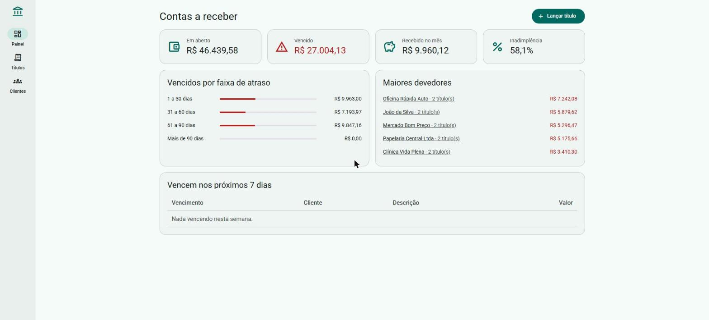
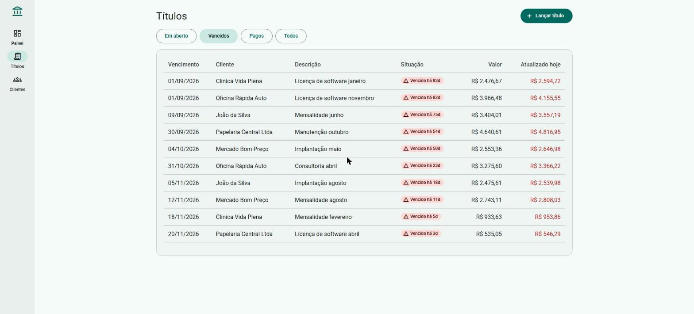
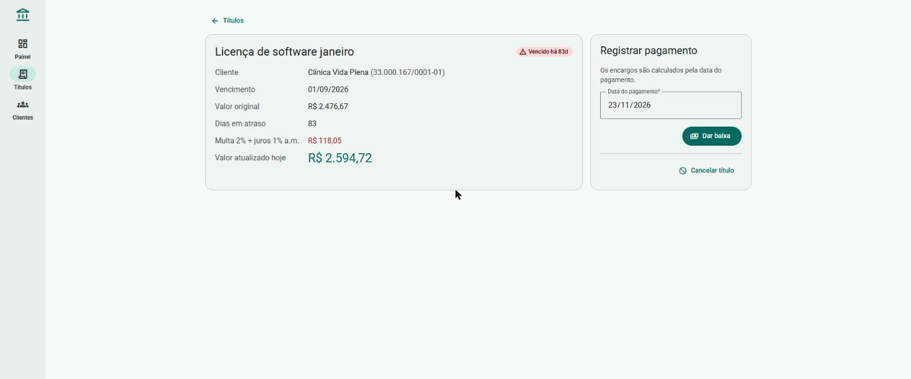

# Financeiro · Contas a Receber (Laravel)

> Projeto de portfólio: o módulo financeiro de um mini-ERP.

Gestão de contas a receber: cadastro de clientes com validação de CPF/CNPJ, lançamento de títulos, baixa de pagamento com **multa e juros de atraso**, títulos vencidos agrupados por faixa de atraso (aging), ranking de maiores devedores e índice de inadimplência.



## Stack

- **Laravel 13** (PHP 8.4), Eloquent, migrations, factories e seeders
- **Material Web**: componentes Material 3 oficiais do Google, com tema próprio por tokens de cor
- **PHPUnit**: 22 testes (unitários e de feature, com banco SQLite em memória)

## Regras de negócio

- **Encargos por atraso**, no padrão de boleto: multa única de 2% + juros de mora de 1% ao mês, pro rata dia, sobre o valor original. O cálculo é feito pela **data do pagamento**, não pela data de hoje (`App\Support\Encargos`).
- **Dinheiro em centavos** (inteiros) no banco e nos cálculos. A entrada aceita o formato brasileiro (`1.234,56`).
- **Ciclo do título:** `aberto → pago` ou `aberto → cancelado`. Não aceita pagar duas vezes, pagar com data futura nem cancelar título pago. As violações viram mensagem na tela, não erro 500.
- **CPF/CNPJ** validados pelos dígitos verificadores (`App\Rules\CpfOuCnpj`), guardados só com dígitos e exibidos com máscara.

| Vencidos com valor atualizado | Baixa com encargos |
|---|---|
|  |  |

## Como rodar

Com PHP 8.3+ e Composer:

```bash
composer install
cp .env.example .env && php artisan key:generate
php artisan migrate --seed     # carteira de demonstração
php artisan serve              # http://localhost:8000
php artisan test
```

Ou só com Docker:

```bash
docker run --rm -v "$PWD:/app" -w /app composer:2 composer install
docker run --rm -v "$PWD:/app" -w /app composer:2 php artisan migrate --seed
docker run --rm -p 8000:8000 -v "$PWD:/app" -w /app composer:2 php artisan serve --host=0.0.0.0
```

## Estrutura

```
app/
  Enums/StatusTitulo.php        estados do título
  Models/Titulo.php             regras: atraso, encargos, pagamento, cancelamento
  Rules/CpfOuCnpj.php           validação de documento
  Support/Encargos.php          multa + juros pro rata
  Support/Dinheiro.php          centavos ⇄ "R$ 1.234,56"
  Http/Controllers/             painel, clientes, títulos
resources/views/                Blade + Material Web (navigation rail, tabelas, formulários)
tests/Unit, tests/Feature       cálculo, validação e fluxos completos pelo HTTP
```
